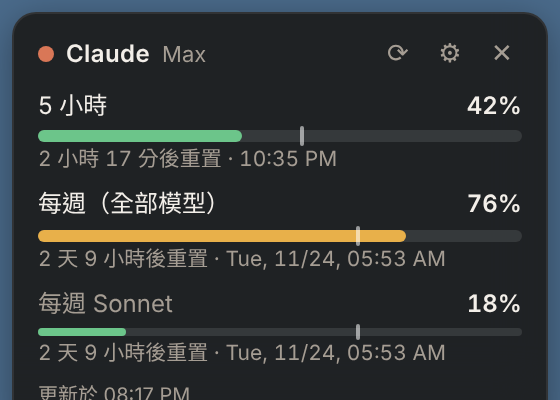

# Clausage

**English** | [繁體中文](README.zh-TW.md)

A tiny, always-on-top desktop widget that shows your **Claude subscription usage limits**: the 5-hour session window, the weekly limit, and per-model weekly limits, each with a reset countdown.

Windows · macOS · Linux



> **Unofficial.** Clausage is a community project, not affiliated with or endorsed by Anthropic. "Claude" is a trademark of Anthropic, PBC. It reads the same private endpoint the claude.ai usage page uses, which may change without notice.

## Features

- 5-hour and weekly usage bars with reset countdowns, plus per-model limits whenever claude.ai provides them
- **Run-out prediction**: "At this pace, runs out in 1h 18m", based on your pace over the last hour
- A **pace marker** on each bar shows how much of the window has elapsed
- **This week by product**: how your weekly usage splits across Claude Code / Chat / Cowork
- **Claude Code tokens per model** (today / 7 days), read from Claude Code's local logs
- **Usage history** charts: 5-hour usage over 24 hours, weekly usage over 7 days
- **Tray icon shows the number** and turns green / amber / red (macOS: menu bar text)
- Notifications at 80% / 95%, when a limit resets, and for extra-usage spending
- **Multiple accounts** in one widget
- Dark / light / system theme, size scaling, opacity, compact mode, click-through mode
- Global hotkey (Ctrl+Alt+C) to show/hide; Ctrl+Alt+Shift+C toggles click-through
- Auto-update from GitHub Releases
- Custom notification thresholds and quiet hours
- Auto-hide while another app is full screen (Windows, optional); snaps to screen edges
- Retries automatically when offline or the network drops; export usage history as CSV
- 10 languages: English, 繁體中文, 简体中文, 日本語, 한국어, Español, Français, Deutsch, Português (Brasil), Русский. Follows your system language. [Add yours](CONTRIBUTING.md#翻譯--translations)

## Install

Download the latest build from [Releases](../../releases):

| OS | File |
|---|---|
| Windows | `Clausage-x.y.z-win-x64.exe` (installer) or the portable `.exe` |
| macOS | `Clausage-x.y.z-mac-universal.dmg` |
| Linux | `.AppImage` or `.deb` |

Builds are not code-signed yet:
- **Windows:** in SmartScreen, click *More info → Run anyway*
- **macOS:** right-click the app → *Open* (first launch only)

## Usage

1. Launch Clausage. A claude.ai login window appears. Sign in, and it closes by itself.
2. The widget now updates every 2 minutes. Drag it by the title bar. Right-click it or the tray icon for options.

If the login window doesn't work for you (Google sign-in blocked, or the email link opens in another browser), go to **⚙ Settings → Paste sessionKey manually**.

### Data sources

| Mode | How it works |
|---|---|
| claude.ai account (default) | Sign in inside the app. It calls `claude.ai/api/organizations/{org}/usage` |
| Claude Code credentials | Reads `~/.claude/.credentials.json` (macOS: Keychain). It calls `api.anthropic.com/api/oauth/usage` |

## Troubleshooting

- **"This account is on the Claude Free plan"**: usage limits exist only for paid plans. If you pay with a different account, right-click the widget → *Sign in to claude.ai…*, sign out inside that window, and sign in with the paid account.
- **Nothing happens on `npm start`**: Clausage is already running. Quit it from the tray icon (or `taskkill /IM electron.exe /F`) first.
- **`Electron failed to install correctly`** (running from source on Windows): run `powershell -ExecutionPolicy Bypass -File scripts\fix-electron.ps1`.
- When running from source, raw API responses are saved to `debug/` (gitignored). Attach the relevant parts to bug reports **after removing your email and org IDs**.

## Privacy

- Your session lives only in the app's local profile folder
- Requests go only to `claude.ai` or `api.anthropic.com`
- No telemetry, no analytics, no third-party servers

## Build from source

```bash
npm install
npm start          # run
npm run dist:win   # or dist:mac / dist:linux
```

See [CONTRIBUTING.md](CONTRIBUTING.md) and the [roadmap](docs/ROADMAP.md).

## License

[MIT](LICENSE)
