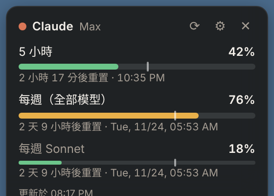

# Clausage

[English](README.md) | **繁體中文**

浮動在桌面最上層的小工具，即時顯示 **Claude 訂閱方案使用量**：5 小時額度、每週額度、各模型分項，以及重置倒數。

支援 Windows · macOS · Linux



> **非官方專案。** 與 Anthropic 無關，也未經其背書；「Claude」為 Anthropic, PBC 的商標。本工具讀取 claude.ai 使用量頁面所用的非公開介面，可能隨時變更而失效。

## 功能

- 5 小時、每週用量條與重置倒數；claude.ai 有提供時，也會顯示各模型的個別額度
- **用完時間預測**：「照目前速度，約 1 小時 18 分後用完」，依最近一小時的使用速度估算
- **時間進度刻度**：用量條超過刻度，代表用得比時間快
- **本週用量來源**：每週用量在 Claude Code、對話、Cowork 之間的分配
- **Claude Code 各模型 token 用量**（今天／7 天），讀取本機紀錄
- **用量歷史圖**：過去 24 小時的 5 小時用量、過去 7 天的每週用量
- **系統匣圖示直接顯示百分比**，並依用量變綠、黃、紅（macOS 顯示在選單列）
- 用量達 80%／95%、額度重置時通知；顯示額外用量的本月花費
- **多帳號**同時顯示
- 深色／亮色／跟隨系統主題、大小縮放、透明度、精簡模式、滑鼠穿透
- 全域快捷鍵 Ctrl+Alt+C 顯示或隱藏，Ctrl+Alt+Shift+C 切換滑鼠穿透
- 從 GitHub Releases 自動更新
- 自訂通知門檻、勿擾時段
- 其他程式全螢幕時自動隱藏（Windows，可選）；拖曳靠近邊緣自動貼齊
- 離線或斷線時自動重試；用量紀錄可匯出 CSV
- 介面支援 10 種語言：English、繁體中文、简体中文、日本語、한국어、Español、Français、Deutsch、Português (Brasil)、Русский，跟隨系統語言自動切換

## 安裝

到 [Releases](../../releases) 下載：

| 系統 | 檔案 |
|---|---|
| Windows | `Clausage-x.y.z-win-x64.exe`（安裝版）或 `Clausage-x.y.z-win-x64-portable.exe`（免安裝版） |
| macOS | `Clausage-x.y.z-mac-universal.dmg` |
| Linux | `.AppImage` 或 `.deb` |

目前尚未簽章：
- **Windows**：SmartScreen 點「其他資訊 → 仍要執行」
- **macOS**：第一次開啟時對 App 按右鍵 →「打開」

## 使用

1. 啟動後會跳出 claude.ai 登入視窗，登入後自動關閉。
2. 之後每 2 分鐘更新一次。拖曳標題列可以移動，右鍵小工具或系統匣圖示可以開選單。

登入視窗無法使用時（Google 登入被擋，或 email 連結開到外部瀏覽器）：**⚙ 設定 → 手動貼上 sessionKey**。

## 疑難排解

- **顯示「此帳號為 Claude 免費方案」**：只有付費方案才有用量額度資料。如果你的付費方案在另一個帳號，對小工具按右鍵 →「登入 claude.ai…」，在視窗內登出，再改用付費帳號登入。
- **`npm start` 沒反應**：表示 Clausage 已經在執行。先從系統匣圖示結束（或執行 `taskkill /IM electron.exe /F`）。
- **`Electron failed to install correctly`**（在 Windows 從原始碼執行時）：執行 `powershell -ExecutionPolicy Bypass -File scripts\fix-electron.ps1`。
- 從原始碼執行時，API 原始回應會存在 `debug/`（不會被 git 提交）。回報問題時可以附上相關內容，**但請先刪掉 email 和組織 ID**。

## 隱私

- 登入資料只存在本機的 App 設定資料夾
- 只會連線到 `claude.ai` 或 `api.anthropic.com`
- 沒有任何遙測、分析或第三方伺服器

## 從原始碼建置

```bash
npm install
npm start
npm run dist:win   # 或 dist:mac / dist:linux
```

## 授權

[MIT](LICENSE)
